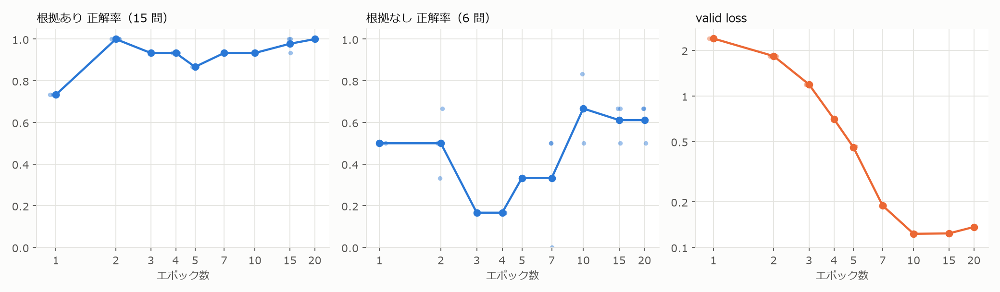

# 第2回 解答

## 演習

- 使ったモデル・設定（`result.json` の `config` から）：`Qwen/Qwen3.5-0.8B`（revision `2fc0636`）、LoRA（量子化なし）、`lora_r=16`、`lora_alpha=32`、`lr=2e-4`、`num_train_epochs=20`（40 ステップ）、`warmup_steps=6`、`seed=42`

- 自分で学習を実行したか（`executed_training_myself`）：はい（実行できた範囲：セクション 0〜8 のすべて
- 学習前：`format_rate` = 0.095（2/21） / `content_rate` = 0.000（0/21）
- 学習後：`format_rate` = 1.000（21/21） / `content_rate` = 0.952（20/21）
- 退行した質問：なし（`regressed` は空）
- 学習後に残った失敗と、その型（根拠なしの質問に断定した / 根拠ありの質問に確認要求で逃げた / 形式の崩れ）：
  - 「オフィスアワーは事前予約が必要ですか」（正解は `needs_review: true`）という質問に対して、FAQ のオフィスアワーの文をそのまま返し、`needs_review: false` として回答してしまった。質問の語（オフィスアワー）が FAQ の項目と一致したため、その項目を当てはめたと思われる。
  - 形式の崩れは 0 件、根拠ありの質問に確認要求した例も 0 件だった
- 知識を問う質問（セクション 6）の結果（学習前の分類 → 学習後の分類）と気づいたこと：

  | 質問 | 学習前 | 学習後 |
  |---|---|---|
  | この講座の最終課題の締切はいつですか（FAQ に無い） | format_error | asserted|
  | 担当教員の名前は何ですか（FAQ に無い） | format_error | needs_review |
  | 次回の講義のテーマは何ですか（FAQ に無い） | format_error | needs_review |
  | 課題の提出期限はいつですか（対照、FAQ にある） | format_error | asserted|

  学習前の回答は4問とも `needs_review` が欠けて形式違反になった。学習後の回答は FAQと単語が被らない質問（教員名、講義テーマ）に対して確認を求めたものであった。一方で、「最終課題の締切」は FAQ の「課題の提出期限」と単語が被っているため、課題の期限の文を流用して回答していた。このとき、モデルは質問の中身ではなく、FAQの項目と同じ単語を持つかどうかを基準に答えを選んでいるように思われる。
- 学習で変わったこと・変わらなかったこと：
  - 変わったこと：形式の遵守率が 0.095 から 1.000 になった。学習前の失敗 19 件はすべて `missing_key` で、`{"answer": "9 月 30 日 23:59"}` のように `needs_review` のキーを回答しなかった。学習後は答えの文面も FAQ の原文に揃うような傾向がみられた。学習したパラメータは全体の 0.84%で、学習時間は 229 秒、loss は 1.55（10 ステップ目）から 0.014（40 ステップ目）まで下がった。
  - 変わらなかったこと：FAQ に根拠があるかどうかの判断は、学習後も単語の一致に頼っている。単語が被っているだけで根拠なしの質問にも断定的な回答をしてしまっていた。
  - セクション 8（4bit、学習なし）：重みのメモリは 3.01GB から 0.76GB になった。`format_rate` は 0.095 から 0.667、`content_rate` は 0 から 0.333 に上がった。ただし根拠なしの 6 問はすべて、「はい」「なし」と断定した回答が見られた。

## 宿題

宿題は 3 レベルとも行った。結果のファイルは `lectures/02/homework/{basic,impl,advanced}/` にある。演習と基礎は T4 で実行し、実装と発展は L4 で実行した（T4 の同時割り当てが 2 台までだったため）。学習前後の比較はそれぞれ同じ GPU で行っている。

### 基礎

- 変えた設定やデータ：`num_train_epochs` を 1、2、3、4、5、7、10、15、20 の 9 点で振った。ほかの設定は演習と同じ。各点を乱数シード 0、2、42の3つで学習し、計27回の結果を確認した。
- 結果（比較表や数字）：　値は 3シードの平均で、括弧内は標準偏差である

  

  | エポック | ステップ | format_rate | content_rate | 根拠あり（15 問） | 根拠なし（6 問） | 最終 loss | valid loss | 学習時間 |
  |---|---|---|---|---|---|---|---|---|
  | 1 | 2 | 0.905（0） | 0.667（0） | 0.733 | 0.500 | 2.47 | 2.39 | 12 秒 |
  | 2 | 4 | 1.000 | 0.857（0.048） | 1.000 | 0.500（0.167） | 2.13 | 1.83 | 22 秒 |
  | 3 | 6 | 1.000 | 0.714（0） | 0.933 | 0.167 | 1.50 | 1.19 | 34 秒 |
  | 4 | 8 | 1.000 | 0.714（0） | 0.933 | 0.167 | 0.82 | 0.70 | 47 秒 |
  | 5 | 10 | 1.000 | 0.714（0） | 0.867 | 0.333 | 0.46 | 0.46 | 58 秒 |
  | 7 | 14 | 1.000 | 0.762（0.083） | 0.933 | 0.333（0.289） | 0.16 | 0.19 | 81 秒 |
  | 10 | 20 | 1.000 | 0.857（0.048） | 0.933 | 0.667（0.167） | 0.055 | 0.123 | 113 秒 |
  | 15 | 30 | 1.000 | 0.873（0.055） | 0.978（0.038） | 0.611（0.096） | 0.020 | 0.124 | 172 秒 |
  | 20 | 40 | 1.000 | 0.889（0.028） | 1.000 | 0.611（0.096） | 0.014 | 0.136 | 230 秒 |

  最終 loss は最後の 1 ステップの値である。標準偏差を書いていない欄は、3 シードで値が同じだった。

- 考察：
  - 正解率: エポック数に対して単調ではなく、次の 3 段階に分かれる
    - 1〜2エポック：形式だけが身につく段階。学習率は warmup 中でまだ小さく、loss も 2 前後のままだが、2 エポックで形式は 21/21、根拠ありは 15/15 になった。答えの中身は、モデルがプロンプトの FAQ を読んで作っている。
    - 3〜7エポック：教師データの文を覚えかけて、正解率が下がる段階。FAQ の文を途中で繋ぎ変えた出力が出る（「FAQ には記載がありません。期限後の提出は減点のうえ受け付けます。」）。根拠なしの質問への定型文が「確認が必要」まで出ずに切れる失敗も多い。根拠なしの正解は 1/6 まで落ちた
    - 10エポック以降：教師データの文を丸ごと再現する段階。根拠ありは 15/15 に戻るが、根拠なしは 0.61〜0.67 で頭打ちになる。valid loss は10エポックで最小（0.123）になり、20エポックをわずかに上がった。10エポックでは、定型文の「確認」が欠ける失敗と、根拠ありの質問で確認要求に逃げる失敗が残っていた。20 エポックで残った失敗は、すべて根拠なしの質問への断定である。「オフィスアワーは事前予約が必要ですか」「成績はいつ出ますか」という質問に、FAQ の別項目を当てはめた
  - 学習のばらつき：3 シードの標準偏差は、内容正解率で最大 0.083（7 エポック）だった。21 問では 1 問が 0.048 に当たるので、シードの違いで変わるのは 1〜2 問である。3〜5 エポックでは 3 シードとも同じ値になった。一方、test を 21 問に固定しているので、問題の選び方による誤差は見積もれていない。
  - 形式を身につけさせるだけなら、2エポックで事足りた。根拠なしの判断は、学習を何周しても 0.67 を超えなかった。エポック数で調整できるのは文面の再現度までで、根拠の有無の判断は学習量では直らなかった。そのため、より多くのデータセットを用意することや、RLを用いたalignmentの対応が必要だと考えられる。

### 実装

- 変えた設定やデータ：題材を、架空の「架空大学 中央図書館」の利用案内（5 項目）に置き換えた。実在の大学の規則と取り違えないよう、大学名は実在しないものにした。

  | キー | FAQ の文 | 正解に含むべき語 |
  |---|---|---|
  | hours | 開館時間は平日 8:45〜21:00、土曜 10:00〜17:00 です。 | 8:45、21:00 |
  | loan | 学部生の貸出は 10 冊まで、貸出期間は 2 週間です。 | 10 冊、2 週間 |
  | closed | 日曜・祝日と、入試期間中は休館します。 | 日曜 |
  | entry | 入館するときは、学生証を入館ゲートにかざしてください。 | 学生証 |
  | return | 閉館中の返却は、正面入口横のブックポストに入れてください。 | ブックポスト |

- 「根拠なし」の質問の用意のしかた：2 種類を用意した
  - FAQ と話題が重ならない質問。駐車場、Wi-Fi、飲食、DVD の視聴、コピー料金などで、train / valid / test に振り分けた
  - FAQ と同じ語を含むが FAQ では答えられない質問（test 専用の 4 問）。「返却が遅れたらペナルティはありますか」（返却）、「大学院生は何冊まで借りられますか」（FAQ は学部生だけ）、「他大学の学生も入館できますか」（入館）、「電子ジャーナルは学外から読めますか」。演習で「語が重なると断定する」傾向が見えたので、それを確かめるために入れた
- 結果（比較表や数字）：

  | | format_rate | content_rate | 根拠ありの正解 | 根拠なしの正解 |
  |---|---|---|---|---|
  | 学習前 | 0.190（4/21） | 0.000 | 0/15 | 0/6 |
  | 学習後 | 1.000（21/21） | 0.810（17/21） | 14/15 | 3/6 |

  学習時間は 68 秒（L4）、loss は 1.65 から 0.016 に下がった。学習後の失敗 4 件は次のとおり。
  - 根拠なしに断定的な回答：単語が被る4問のうち3問で、類似した項目の文を当てはめて回答していた。ペナルティにはブックポストの文、大学院生には学部生の貸出の文、他大学の学生には学生証の文を返した。
  - 根拠ありを取り違え：「借りた本はいつまでに返せばいいですか」（正解は貸出期間）に、返却場所（ブックポスト）の文を返した。返すという語に引っ張られたと考えられる。
  - 知識質問では、館長名と蔵書数には確認を求めた。一方で、「次の図書館ガイダンスはいつ開かれますか」には開館時間の文で断定してしまった。
- 考察：題材を変えても、演習と同じ型の失敗を再現した。形式は 21/21守れるようになる。しかし根拠の有無は単語の被りで決まり、紛らわしい根拠なしの質問は4問中3問を断定してしまった。学習データの根拠なしの例は、FAQ と話題が離れた質問だけだった。そのため、単語は重なるが答えられない例を学ぶ機会がなかった。この判断を学習で身につけさせるなら、紛らわしい根拠なしの例を trainに含める必要がある。

### 発展

- 変更点：
  - 学習データ：`uv run python scripts/make_sft_dataset.py` の出力をそのまま使った（58 語 × 2 テンプレートで 116 件
  - 設定：`num_train_epochs=10`（150 ステップ）、`warmup_steps=10`、`max_new_tokens=160`。
  - 評価用の質問は 27 問で、3 群に分けた
    - seen（10 問）：用語集にある語を、学習と同じ言い回し（「『LoRA』とは何ですか？」）で聞く
    - para（10 問）：言い回しや名前を変えて聞く（「Low-Rank Adaptation はどんな仕組みで学習しますか？」「429エラーが返ってくるのはどんなときですか？」など）
    - unknown（7 問）：用語集にない語。実在する語 4 つ（RAG、プロンプトインジェクション、知識蒸留、RLHF）と、講座に存在しない架空の語 3 つ（lec04-review タグ、修了ボーナス課題、講座ポイント制度）
  - 採点：seen と para は、定義の要になる語句（例：LoRA なら「低ランク」と「固定」）がすべて回答に含まれれば正解とした。unknown は、用語集にない、または知らないと答えれば正解とした
- 結果（比較表や数字）：

  | | seen | para | unknown（知らないと答えた） |
  |---|---|---|---|
  | 学習前 | 0/10 | 0/10 | 0/7 |
  | 学習後 | 10/10 | 2/10 | 0/7 |
  | 用語集の検索 | 10/10 | 10/10 | 5/7 |

  学習後の unknown は、自動採点では 1/7 だった。しかし、RLHFの回答は「回答が正しいかを確認し」の「確認」に反応しただけで、中身は断定的だった。そのため 0/7 に直した。paraの正解2問のうち、過学習の回答は定義の原文と同じ文だった。

- ファインチューニングが向く場面・向かない場面についての考察：
  - 向く場面：出力の形式や型を揃えること。演習、基礎、実装のすべてで、数十ステップの学習で JSON の形式が 21/21 守れるようになった。基礎のgrid searchでは、2エポックで形式が揃った。学習データと同じ言い回しで聞かれた内容を、そのまま返すことにも向いている。
  - 向かない場面：事実の知識を持たせて、言い回しの違う質問に答えさせること。発展では、学習した 58 語の定義を同じ言い回しでは完全に返せたが、言い回しを変えると 2/10 に悪化した。さらに知らない語には 0/7 で、用語集の文体で断定した。用語集のように更新される事実は、第3回のエージェントのように検索して渡す方が向いていると考える。検索なら言い回しを変えても正しい定義に当たり、用語集を書き換えるだけで最新に保てる。
  - 根拠の有無の判断：FAQ の課題では、`needs_review` で確認を求める振る舞い自体は学習できた。ただし、どの質問に確認を求めるかは単語の被りで決まっていた。紛らわしい根拠なしの質問を学習データに入れない限り、この判断は学習では保証できなかった。発展では「知らない」と答える例を学習データに入れなかったので、確認を求める振る舞いは1件も出なかった
  - 組み合わせ：検索でも、近い語の別の定義が返る失敗がある（RAG、プロンプトインジェクション）。そのため、検索で根拠を渡し、ファインチューニングでは「根拠が質問と合わないときは確認を求める」形式を教える、という分担が考えられる
